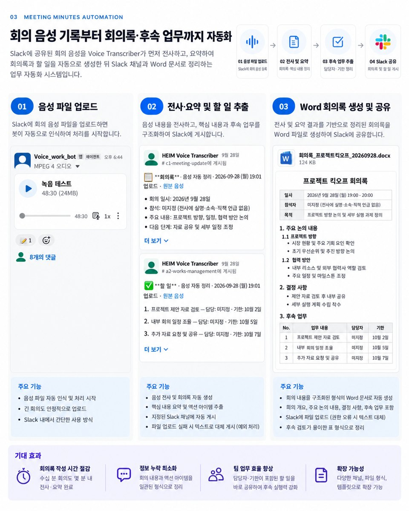
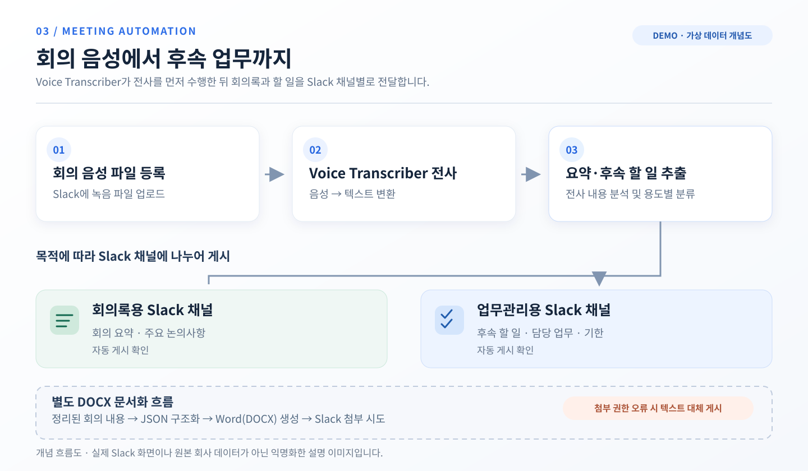

# Venture Operations & AI Automation Portfolio
### 허유나 · Yoona Heo

초기기업 액셀러레이팅 업무에서 기업 정보, 회의 기록, 후속 업무가 흩어져 생기는 누락을 줄이기 위해 **업무 흐름을 설계하고 시스템과 자동화로 구현한 경험**을 정리했습니다. 아래 이미지는 기능을 이해하기 위한 **가상 데이터 기반 설명용 시각화**입니다.

## 한눈에 보기

| 프로젝트 | 해결하려던 문제 | 제가 한 일 | 자세히 보기 |
|---|---|---|---|
| **Venture Operations ERP** | 기업·미팅·투자 연계 정보를 한곳에서 보기 어려움 | 기업 중심 정보 구조와 관리 화면, 업무 흐름 설계·구현 | [프로젝트 01](projects/01-venture-operations-erp.md) |
| **AI Operations Automation** | 요청·결정·할 일의 후속 점검과 보고가 반복됨 | 기록을 요약·분류하고 일일 점검 및 보고에 연결하는 로직 설계·구현 | [프로젝트 02](projects/02-ai-operations-automation.md) |
| **Meeting Minutes Automation** | 음성 기록을 회의록과 후속 업무로 옮기는 과정에서 누락 발생 | 음성 전사 결과의 채널별 전달과 별도 Word 문서화 흐름 구현 | [프로젝트 03](projects/03-meeting-minutes-automation.md) |

## 대표 사례 · 회의 음성에서 후속 업무까지

> **설명용 이미지:** 실제 Slack 화면이나 운영 성과 캡처가 아닙니다. 이미지의 Word 파일 공유 장면은 구현 흐름을 보여주기 위한 예시입니다. 확인된 실제 Slack 화면에서는 파일 업로드 권한 오류로 DOCX 첨부가 실패했고, 회의록 텍스트가 대체 게시됐습니다. [구현 범위와 확인 근거 보기](projects/03-meeting-minutes-automation.md)

Voice Transcriber가 Slack의 음성을 먼저 전사하고, 회의 내용과 할 일을 분류해 해당 채널에 전달합니다. 별도의 문서화 구성요소가 구조화된 내용을 Word 회의록으로 생성합니다.

자동화 흐름도 보기

## 일하는 방식

**실무 문제 발견 → 정보와 업무 구조화 → 기능 구현 → 반복 개선**

기업별 활동 기록이 다음 행동으로 이어지도록 필요한 정보와 사용자를 먼저 정의했습니다. 투자 판단은 담당자가 수행하고, 시스템은 기록·공유·점검을 돕는 역할로 설계했습니다.

## 사용 기술과 공개 범위

- **Web & Database:** Next.js, React, TypeScript, Supabase, SQL
- **AI & Workflow:** Google Gemini, 업무 모니터링·보고 루틴
- **Documents & Integration:** Python, JSON, OOXML/DOCX, Bash, Slack Web API

이 저장소는 개인의 업무 설계·개발 경험을 설명합니다. 회사 원본 코드, 실제 기업·투자자료, 회의록, 개인정보 및 인증정보는 포함하지 않습니다. 일부 투자 딜 화면에는 목업 데이터가 있고, 모든 기능의 실제 운영 여부나 시간 절감 수치는 검증하지 않았습니다. 일일 점검·주간 보고 기능과 계획 단계 기능도 [프로젝트별 문서](projects/02-ai-operations-automation.md)에서 구분했습니다.

[공개 전 확인 항목](PUBLICATION_CHECKLIST.md) · [LinkedIn](https://www.linkedin.com/in/imyoonaheo/)
