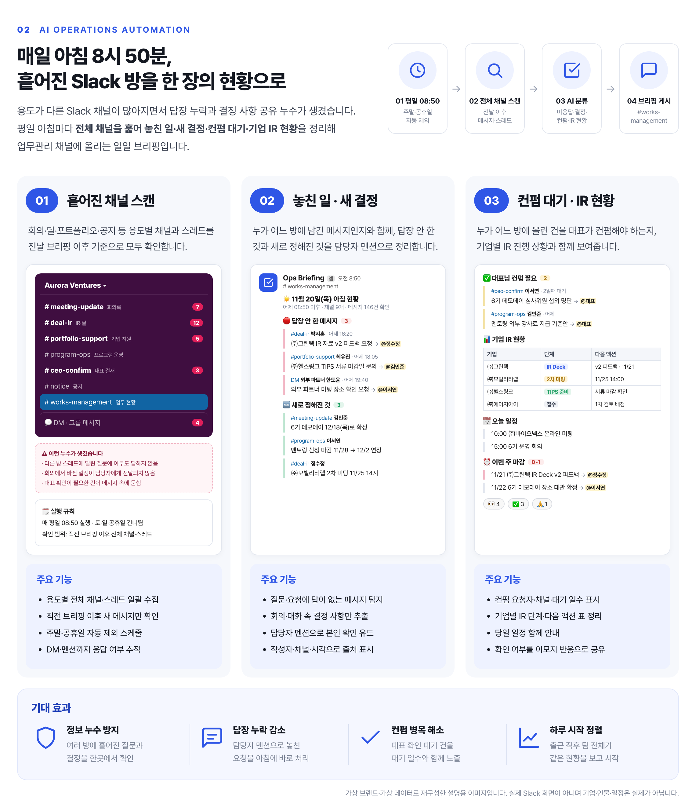

# 02 · AI Operations Automation

**AI Summarization · Follow-up Monitoring · Reporting**

## 문제 정의
여러 초기기업을 동시에 지원하면서 미팅 내용을 정리하고 다음 액션을 추적하며 관리 현황을 보고하는 업무가 반복됩니다. 기록을 후속 행동으로 연결하는 프로세스를 개선하기 위해 AI 기반 기능을 설계·구현했습니다.

## 일일 업무 브리핑

용도가 다른 Slack 채널이 많아지면서 다른 방에 남겨진 질문에 답이 누락되거나, 새로 정해진 사항과 대표 컨펌이 필요한 건이 메시지 속에 묻히는 일이 생겼습니다. 이를 줄이기 위해 **평일 아침 8시 50분(주말·공휴일 제외)마다 전체 채널을 훑어 업무 현황을 정리하는 브리핑**을 만들었습니다.

- 답장하지 않은 메시지: 누가 어느 방에 남긴 요청인지와 담당자 멘션
- 새로 정해진 사항: 회의·대화 중 확정된 일정과 변경 사항
- 대표 컨펌 필요: 요청자·채널·대기 일수
- 기업 IR 현황과 오늘 일정·이번 주 마감

*Figure 1. 가상 브랜드·가상 데이터로 재구성한 **설명용 이미지**입니다. 실제 Slack 화면이 아니며, 이미지 속 기업·인물·일정은 실제가 아닙니다.*

## 코드에서 확인한 기능
- Google Gemini 기반 미팅 내용 요약 및 To-do 추출
- 기업별 회의 기록과 후속 할 일 연결
- 연락 지연·마감 임박·미처리 업무 등 일일 점검 로직
- 주간 관리 현황 보고 및 주요 변경 내용 정리
- AI 알림·수정 이력·되돌리기 관련 구조

## 운영 단계 구분
원본 ERP의 AI 직원 설정에서 일일 점검 및 주간 보고 역할은 `active`, 음성 기반 기록과 자동 시스템 개선 역할은 `planned`로 표시되어 있습니다. 따라서 전체 음성 전사 및 시스템 수정이 완전 자동 운영되고 있다고 주장하지 않습니다.

## 프로젝트 관점
단순히 AI 서비스를 사용하는 데 그치지 않고, 어떤 데이터를 확인해야 업무 누락을 줄일 수 있는지 정의하고 AI 결과를 실무자가 검토할 수 있는 형태로 연결하는 데 집중했습니다.

**공개 범위:** 원본 프롬프트, 인증정보, 기업별 내부 기록이나 실제 보고서를 공개하지 않습니다.
