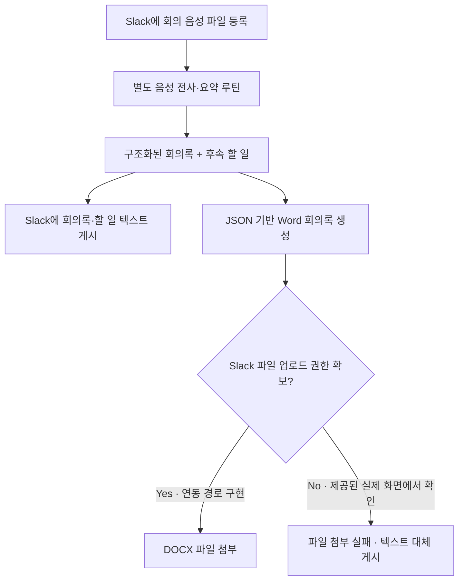

# 03 · Meeting Minutes Automation

**Voice Workflow · AI Summary · Structured DOCX · Slack Integration**

## 문제 정의

기업 미팅 이후 음성 기록을 다시 듣고 회의록을 작성한 다음, 결정사항과 후속 할 일을 담당 채널에 공유하는 일은 시간이 많이 들고 누락이 생기기 쉽습니다. 이를 개선하기 위해 **음성 기록을 요약·분류하는 흐름**과 **정리된 회의 내용을 Word 파일로 만들고 Slack에 공유하는 흐름**을 연계했습니다.

## Workflow — 구현 및 검증된 단계 구분

**중요:** 위는 기능 흐름을 설명한 *개념도*입니다. **전체 음성 전사 시스템과 DOCX·Slack 스크립트는 별도 구성요소**이며, 모든 단계가 하나의 운영환경에서 성공적으로 수행됐음을 뜻하지 않습니다.

## 확인된 화면과 구현 근거

| 단계 | 확인 내용 | 확인 범위 |
|---|---|---|
| 음성 파일 입력 | Slack에 약 48분 분량의 테스트 녹음 게시 | 제공된 화면 |
| 회의록·할 일 정리 | 전사 내용을 정형화해 별도 회의록·To-do 메시지 게시 | 제공된 Slack 화면 |
| DOCX 자동 생성 | JSON을 받아 Word 양식의 OOXML을 수정하는 스크립트 | 제공된 소스 및 예제 생성 시험 |
| Slack 파일 첨부 | 봇의 메시지·파일 업로드 로직 | 스크립트 구현 확인. 실제 화면에서는 `files:write` 권한 누락으로 업로드 실패 |
| 오류 시 대체 게시 | DOCX 첨부가 불가능한 경우 회의록 본문을 텍스트로 게시 | 제공된 Slack 화면 |

## 사용 기술

- **Python 3, JSON, OOXML/DOCX:** 회의 메타데이터와 주요 항목을 Word 파일로 변환
- **Bash, curl, Slack Web API:** Slack 메시지·스레드 게시 및 문서 첨부 연동
- **별도 전사·요약 루틴:** 음성 내용의 회의록 구조화와 후속 업무 추출. 이 저장소의 DOCX 생성 스크립트와 구분

## Demo Scenario — fictional data

실제 업무 데이터 대신 **가상의 프로젝트 회의**를 사례로 구성하면 입력과 출력의 관계를 안전하게 설명할 수 있습니다.

| 단계 | 가상 데모 내용 |
|---|---|
| 입력 | '샘플 프로젝트 진행 회의' 녹음 파일 |
| 회의록 | 진행 현황, 주요 논의사항, 결정사항 |
| 후속 업무 | '문서 초안 보완' · '다음 회의 일정 확인' |
| 공유 | 회의록·할 일을 Slack에 게시하고, Word 문서 생성 결과를 별도로 확인 |

실제 Slack 캡처에는 업무상 기업·투자 논의, 날짜·기한, 채널 및 담당자 정보가 포함되어 있으므로 원본 이미지는 게시하지 않습니다. 가상 데이터로 재현한 화면에 **“DEMO · 가상 데이터”** 표시를 추가하고 회사 승인 범위를 확인한 뒤 공개용 캡처를 등록하는 방식이 적절합니다.

## 검증 범위 및 한계

- 제공된 원본 ZIP의 문서 생성·공유 스크립트 및 입력 구조를 검토했습니다.
- 예제 입력을 사용한 DOCX 생성 시험에서 문서 및 주요 섹션 입력을 확인했습니다.
- 실제 Slack 화면에서는 **자동 회의록 및 후속 할 일 텍스트 게시**가 확인됩니다.
- 동일 화면에서 **Word 파일의 Slack 업로드는 실패**했습니다(`missing_scope: files:write`). 해당 화면을 성공 사례로 사용하지 않습니다.
- 전체 전사 루틴의 신뢰도, Slack 파일 업로드 성공률, 절감 시간 등 정량적 운영 성과는 별도 검증하지 않았습니다.

**공개 범위:** 회사 원본 코드·Word 양식·실제 회의 내용·인증정보·Slack 채널 식별자는 공개하지 않습니다.
