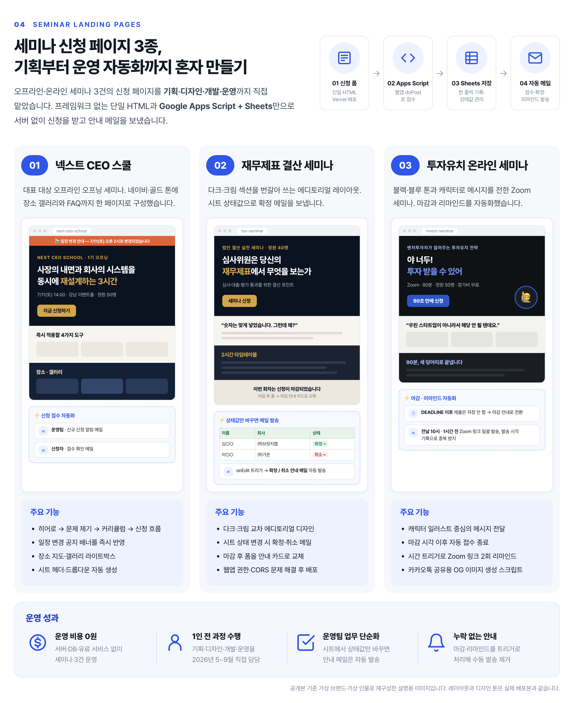
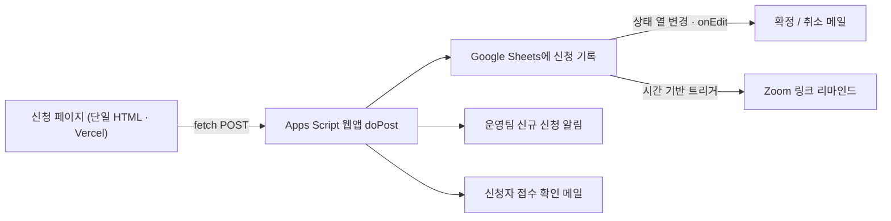

# 04 · Seminar Landing Pages

**Landing Page Design · Serverless Form · Google Apps Script · Email Automation**

## 문제 정의

세미나를 열 때마다 신청 페이지를 만들고, 신청자를 정리하고, 접수 확인·참석 확정·접속 링크 안내 메일을 일일이 보내는 일이 반복됩니다. 별도 개발 인력이나 예산 없이 이 과정을 운영할 수 있도록 **신청 페이지와 접수·안내 메일 흐름을 직접 만들었습니다.**

## 한눈에 보기

*Figure 1. 공개용 사본을 바탕으로 재구성한 **설명용 이미지**입니다. 회사명·행사명·진행자는 가상 브랜드와 가상 인물로 바꿨고, 레이아웃과 디자인 톤은 실제 배포본과 같습니다.*

## 작업 범위

2026년 5~9월에 진행한 오프라인·온라인 세미나 3건의 신청 페이지를 **기획·디자인·개발·운영**까지 맡았습니다.

| 페이지 | 형식 | 운영 자동화 |
|---|---|---|
| 넥스트 CEO 스쿨 1기 오프닝 세미나 | 오프라인 · 정원 50명 | 접수 저장, 운영팀 알림, 신청자 접수 확인 메일 |
| 재무제표 결산 세미나 | 오프라인 · 정원 40명 | 시트 상태값(확정/취소) 변경 시 안내 메일 자동 발송 |
| 투자유치 전략 온라인 세미나 | Zoom · 정원 50명 | 마감 시각 이후 접수 종료, 전날·1시간 전 접속 링크 리마인드 |

## 구조

- 프레임워크 없이 **단일 HTML**로 만들어 Vercel에 배포했습니다.
- 신청 폼은 **Google Apps Script 웹앱 → Google Sheets**로 받아 서버·DB·유료 서비스 없이 운영했습니다.
- 운영팀은 시트에서 상태값만 바꾸면 되고, 안내 메일은 스크립트가 보냅니다.

## 설계하면서 해결한 것

- 웹앱 접근 권한을 도메인으로 제한하면 외부 브라우저에서 CORS·리다이렉트 오류로 제출이 실패해, 권한 범위를 조정해 배포했습니다.
- 마감 이후 제출은 저장하지 않고, 페이지가 마감 안내로 바뀌도록 처리했습니다.
- 리마인드 메일은 발송 시각을 시트에 기록해 중복 발송을 막았습니다.
- 행사 일정이 바뀐 경우 상단 공지 배너로 즉시 안내했습니다.

**기술:** HTML/CSS/JavaScript, Google Apps Script, Google Sheets, Vercel, Python(OG 이미지 생성).

## 확인 범위

공개용 사본의 페이지 코드와 Apps Script를 기준으로 작성했습니다. 신청자 수, 전환율 등 운영 수치는 포함하지 않았습니다.

**공개 범위:** 실제 회사명·진행자 정보·행사장·연락처·배포 URL·신청자 데이터는 포함하지 않습니다.
